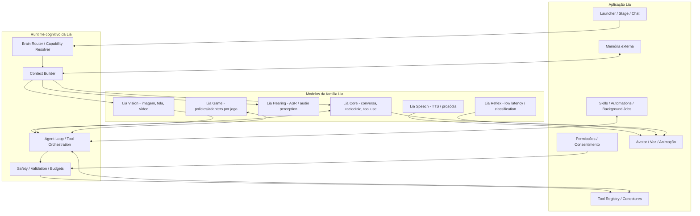

# 03 — Arquitetura alvo do ecossistema de modelos

> **Atualização Missão 001 (2026-10-30):** documento v1.0 preservado. Consulte o [índice da pesquisa e correções](README.md), a [auditoria](research/00-PROJECT-AUDIT.md) e as [fontes atuais](research/SOURCES.md). Afirmações históricas não comprovam validação nesta missão.

## 1. Princípio

**Lia Model Lab entrega modelos e pesos. Lia Runtime entrega comportamento operacional seguro.** Os dois projetos são acoplados por contratos públicos e versionados, não por imports de implementação.

## 2. Arquitetura conceitual



## 3. Componentes e suas responsabilidades

### 3.1 Lia Core

Cérebro conversacional de uso geral. Primeira base a adaptar. Responsável por linguagem, pt-BR, personalidade, instrução, raciocínio e tool-use. Pode receber adapters separados quando houver benefício comprovado.

### 3.2 Lia Vision / Perception

Se a base escolhida já for VLM, manter visão no mesmo checkpoint na primeira geração. Se a visão aumentar muito a latência/custo ou a arquitetura dificultar deployment, rotear para modelo especializado. Responsabilidades: imagem, screenshot, documentos e compreensão temporal de frames/vídeo quando suportado.

### 3.3 Lia Hearing / Speech

Separar ASR de TTS. STT transforma entrada de voz em texto; TTS transforma uma resposta em fala. Modelos end-to-end de áudio podem ser investigados posteriormente, mas o primeiro produto não precisa condensar tudo em um único peso. Voiceprint e biometria vocal têm política e armazenamento próprios.

### 3.4 Lia Agent / Tool-use

Não precisa ser um checkpoint independente no início. Pode ser um adapter/dataset do Lia Core que melhora seleção de ferramentas, argumentos, continuidade e recuperação após erro. O executor, schemas e políticas ficam no runtime.

### 3.5 Lia Game

Trilha especializada. Começar com um ambiente-alvo e um game adapter, não “todos os jogos”. Separar percepção de estado, decisão de alto nível, ação e execução. Treinar com trajetórias rotuladas e testes determinísticos antes de RL.

### 3.6 Lia Reflex

Resposta de baixa latência: detecção/classificação, interrupção, sinais simples de atenção e pequenos eventos. Pode ser código determinístico ou modelo pequeno. Não usar LLM de 27B para blinking, VAD, hotkey ou eventos simples.

### 3.7 Memória externa

Store separado com tipos como episódica, semântica, preferências e social. Cada entrada tem owner/card scope, fonte, timestamp, confiança, sensibilidade, policy/retention e referência de origem. Modelos são consumidores e escritores autorizados, não o banco.

### 3.8 Embodiment

O modelo emite estado estruturado opcional:

```json
{
  "emotion": "curious",
  "intensity": 0.62,
  "gaze_target": "active_window",
  "gesture": "small_point",
  "speech_style": "warm_conversational"
}
```

O runtime valida se os valores existem e o renderer mapeia para expressões, animações, poses, visemes e movimentos. Não treinar o LLM para gerar frames 3D diretamente.

## 4. Linha de evolução

```text
Open foundation model
  -> frozen baseline + evaluation
  -> Lia Core SFT (persona + pt-BR + instruction)
  -> Tool-use / planning SFT
  -> preference alignment (se os dados justificarem)
  -> specialist adapters (vision/game/memory behavior)
  -> merge ou composition controlada
  -> export/quantization variants
  -> runtime integration + conformance tests
```

Continual pretraining e RL não são primeiros passos. Só devem entrar quando houver corpus, objetivo, ambiente e baseline que justifiquem custo e risco.

## 5. Adapter strategy

Manter adaptadores separados no começo:

- `lia-persona`: identidade, estilo, consistência e voz textual.
- `lia-agent`: tool calling, planejamento, execução com feedback.
- `lia-memory-ops`: políticas para extrair/consultar/atualizar/esquecer informação.
- `lia-game-<game>`: um por jogo/ambiente, se teste demonstrar ganho.
- `lia-vision-<task>`: só se a base tiver visão e o tuning da tarefa fizer sentido.

Não criar adapter só para cada integração. Discord pode usar Lia Core + adapter social/tool-use e connector; o canal não precisa de um modelo próprio. Minecraft/Factorio podem exigir especialização de ambiente.

Antes de mergear adapters, testar conflitos, regressões e composição. A arquitetura precisa suportar adapter separado ou merged checkpoint, conforme o runtime escolhido.

## 6. Contrato de inferência

Cada modelo publicado deve declarar:

- `model_id` e `model_revision`;
- `base_model_id` + revision/hash;
- arquitetura/modalidades reais;
- tokenizer e chat template;
- formato de entrada/saída;
- tool schema/protocol suportado;
- max context testado (não copiar apenas o máximo nominal);
- quantização e formatos exportados;
- engines e plataformas testadas;
- uso de reasoning/thinking e parâmetros corretos;
- licenças e notices;
- métrica/limitação conhecida.

O Router da Lia resolve modelo por requisito da tarefa (text, image, audio, tools, video, latency, cost), não por heurística de nome/modelo. Se não existe rota validada, informar/usar fallback explícito; nunca alegar suporte implícito.

## 7. Modelo único versus família

A hipótese inicial é **uma família de modelos interoperáveis**. Um único modelo multimodal pode ser conveniente, mas não é requisito absoluto. Diferentes capacidades têm custos e requisitos muito diferentes. Especialistas podem ser selecionados por tarefa; o produto deve ocultar essa complexidade de usuários comuns.

MoE é uma possibilidade futura, não um pré-requisito. Parâmetros totais, ativos e throughput precisam ser avaliados em cenário real; não escolher MoE apenas por marketing ou contagem total.
